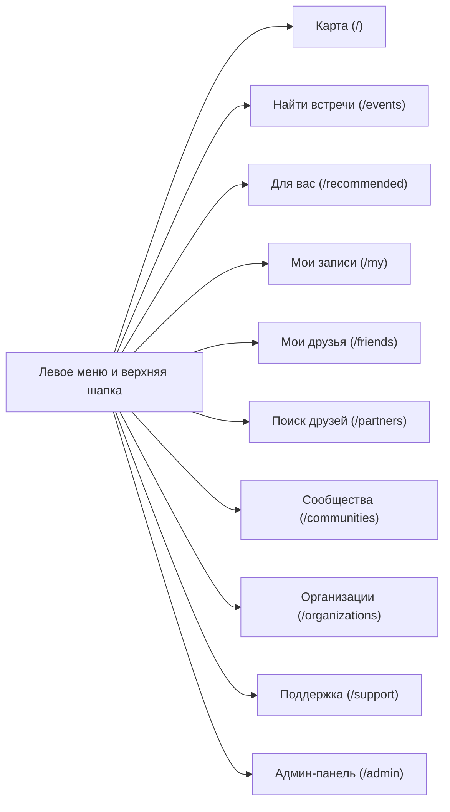

# Брендбук и дизайн-система «Точка Сбора» (v3.1 — Court & Turf Edition)

> [!IMPORTANT]
> **Главная цель дизайн-системы:** уйти от шаблонного перегруженного интерфейса к чистой, журнально-спортивной светлой эстетике с выразительной типографикой (`Unbounded` + `Golos Text`), лаконичными карточками, каплевидными указателями на интерактивной карте и полноценной адаптацией под мобильные экраны.

---

## 1. Философия визуального стиля

1. **Единая светлая палитра (Chalk & Turf) и воздух:** используется тёплая светлая гамма спортивных покрытий (известняк `#F4F3EF`, песочный корт `#EAE8E1`, изумрудный газон `#00B956`, глубокий графит `#121417`) без визуального шума. Тёмная тема полностью убрана для единообразия интерфейса на всех устройствах.
2. **Чистые карточки и маркеры без лишних значков:**
   - На обложках карточек мероприятий отображаются только статус записи («Свободная запись» / «По заявке» / «Онлайн» / «Завершено») и бейдж «Регулярные встречи» — без захардкоженных смайликов и категорий спорта поверх фото.
   - На интерактивной карте используются аккуратные **перевёрнутые каплевидные указатели (Teardrop Pins)** с точным остриём в координате встречи (`#00B956` для обычных и `#FF5A26` для выбранной точки), включая режим выбора координаты при создании и редактировании мероприятия.
3. **Адаптивная картография (Desktop & Mobile):** на десктопе карта работает в формате split-screen со сворачиваемым списком встреч слева и выдвижной карточкой (`Drawer`) справа; на смартфонах предусмотрен удобный переключатель «Карта / Список» и полноэкранные модальные карточки с полным перекрытием фона (`backdrop-blur`).

---

## 2. Типографическая система

Контрастная триада шрифтов со спортивным характером:

| Роль | Шрифт | Начертания | Где применяется |
| :--- | :--- | :--- | :--- |
| **Display / Заголовки и табло** | **`Unbounded`** | `600 SemiBold`, `700 Bold`, `800 ExtraBold` | Логотип «ТОЧКА СБОРА», заголовки страниц и карточек, табло времени начала тренировок (`19:00`), счётчики мест (`4 / 15`). |
| **UI & Body / Основной текст** | **`Golos Text`** | `400 Regular`, `500 Medium`, `600 SemiBold`, `700 Bold` | Боковая навигация, фильтры, описания тренировок, календарь, формы, чаты и таблицы модерации. |
| **Mono / Метрики и коды** | **`JetBrains Mono`** | `500 Medium`, `700 Bold` | Часовые пояса (`МСК UTC+3`), номера обращений (`TCK-10421`), даты и счётчики. |

### Масштабирование шрифта (`Аа`)
В верхней панели сайта доступен переключатель масштаба текста для комфортного чтения пользователями любого возраста:
- **Обычный (`100%`)** — базовый размер `16px`
- **Увеличенный (`112%`)** — комфортное чтение `18px`
- **Крупный (`125%`)** — крупный кегль `20px` с автоматической адаптацией сеток без горизонтального скролла.

---

## 3. Цветовая палитра (Court & Turf — Light Edition)

| Токен | Значение | Назначение |
| :--- | :--- | :--- |
| `--bg-page` | `#F4F3EF` (Тёплый известняк) | Основной фон страниц, не утомляющий глаза |
| `--bg-card` | `#FFFFFF` (Чистый лист) | Карточки событий, календарь, модальные окна, панели |
| `--bg-surface` | `#EAE8E1` (Песочный корт) | Поля ввода, неактивные кнопки и переключатели вкладок |
| `--text-ink` | `#121417` (Глубокий графит) | Заголовки и основной текст |
| `--text-muted` | `#5C626B` (Серый камень) | Вторичные подписи, адреса и подсказки |
| `--border-line` | `#DFDDD4` / `#CFCBC0` | Чёткие структурные разделители карточек |
| `--brand` | `#00B956` (Изумрудный газон) | Главные кнопки действий, прогресс-бары, маркеры карты |
| `--accent-clay` | `#FF5A26` (Грунтовый корт) | Активный пин на карте, важные акценты |

---

## 4. Архитектура навигации и разделов

1. **Карта (`/`)** — интерактивная карта с каплевидными пинами, поиском по всем городам и регионам РФ, голосовым вводом и выдвижной карточкой события, которая сразу показывает текущий статус пользователя («Вы записаны ✓», «Заявка на рассмотрении», «Вы организатор встречи») и мгновенно обновляет свободные места при записи.
2. **Найти встречи (`/events`)** — полноформатный каталог разовых и регулярных тренировок с умным нечётким поиском и фильтрами по виду спорта, дате, уровню подготовки и формату записи.
3. **Мои записи (`/my`)** — интерактивный календарь тренировок (адаптированный под десктоп и мобильные экраны), список предстоящих встреч, архив прошедших мероприятий и управление собственными сборами.
4. **Мои друзья (`/friends`) и Поиск друзей (`/partners`)** — разделены на две самостоятельные вкладки: управление списком друзей с личным чатом и индикатором непрочитанных сообщений (`/friends`) и поиск новых спортивных друзей в режиме «Спорт-дейтинг» или по фильтрам (`/partners`).
5. **Сообщества (`/communities`) и Организации (`/organizations`)** — логически разделены с поиском по названию, городу и виду спорта: открытые пользовательские сообщества создаются обычными участниками, а официальные обезличенные организации проходят верификацию администратором и публикуют мероприятия от имени организации.
6. **Поддержка (`/support`)** — обращения и онлайн-чат с модераторами, включая подачу жалобы с предзаполненным объектом прямо из карточки мероприятия, профиля или организации.
