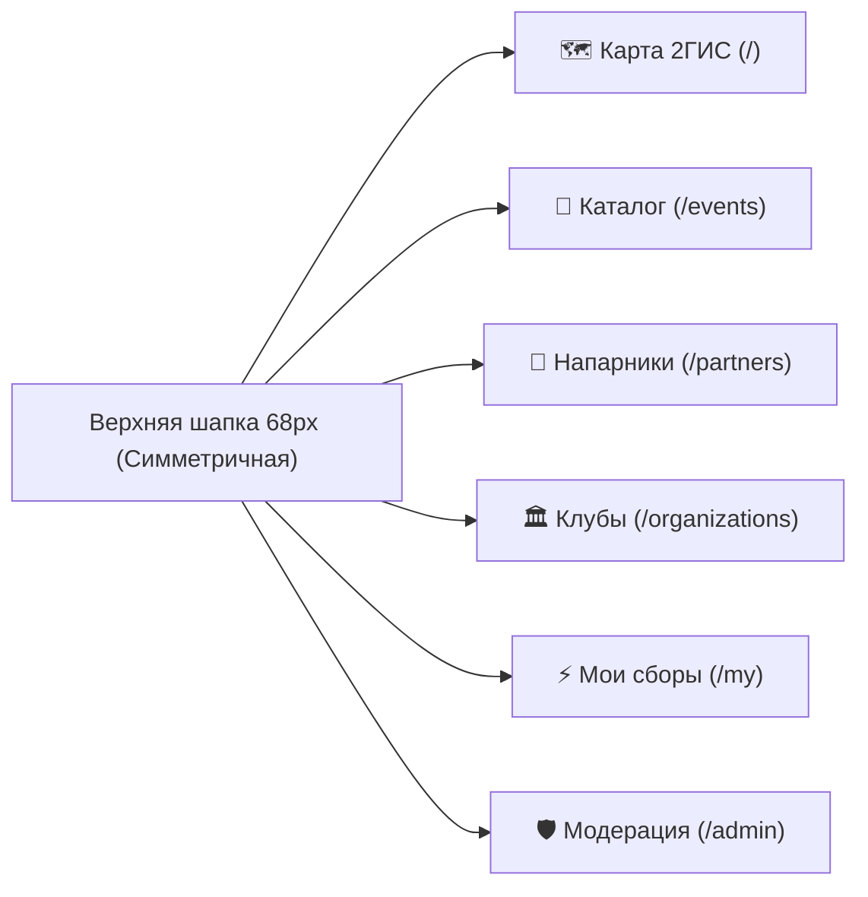

# Брендбук и дизайн-система «Точка Сбора» (v3.0 — Court & Turf Edition)

> [!IMPORTANT]
> **Главная цель редизайна:** уйти от шаблонного «нейрослопного» интерфейса и скученности элементов к чистой, журнально-спортивной эстетике с выразительной типографикой (`Unbounded` + `Golos Text`), симметричной навигацией и нативной картографией **2ГИС**.

---

## 1. Философия визуального стиля

1. **Никакой «каши» и скученности:** каждый экран решает ровно одну понятную задачу. Между карточками, фильтрами и навигацией сохранён архитектурный воздух (`20px–28px`), а элементы управления никогда не обрезают текст многоточиями.
2. **Отказ от ИИ-штампов:** исключены кислотные фиолетово-синие градиенты, лишние декоративные плашки и перегруженные боковые колонки. Вместо них — тактильные оттенки спортивных покрытий (известняк, грунтовый корт, изумрудный газон 2ГИС, графит) и чёткие `1px` границы.
3. **Картография 2ГИС (`2GIS`):** во всех режимах карты используются русскоязычные тайлы **2ГИС** (`https://tile2.maps.2gis.com/tiles?x={x}&y={y}&z={z}&v=1`) с детальной прорисовкой парков, стадионов, корпусов и рельефа, а также прямые переходы в навигатор **2ГИС**.

---

## 2. Типографическая система

Мы используем контрастную триаду шрифтов с ярким спортивным характером:

| Роль | Шрифт | Начертания | Где применяется |
| :--- | :--- | :--- | :--- |
| **Display / Заголовки и табло** | **`Unbounded`** | `600 SemiBold`, `700 Bold`, `800 ExtraBold` | Логотип «ТОЧКА СБОРА», заголовки страниц и карточек, время начала тренировок (`19:00`), счётчики мест (`3 / 15`). |
| **UI & Body / Основной текст** | **`Golos Text`** | `400 Regular`, `500 Medium`, `600 SemiBold`, `700 Bold` | Навигация, фильтры, описания тренировок, формы, чаты и таблицы модерации. Идеальная читаемость кириллицы. |
| **Mono / Метрики и коды** | **`JetBrains Mono`** | `500 Medium`, `700 Bold` | Часовые пояса (`МСК UTC+3`), номера тикетов (`TCK-29135`), даты и статусные индексы. |

### Масштабирование шрифта (Доступность без визуального шума)
В соответствии с требованиями оставлен **только чистый переключатель масштаба текста (`Аа`)** в шапке сайта (все цветовые/чёрно-белые фильтры удалены):
- **Обычный (`100%`)** — базовый размер `16px`
- **Увеличенный (`112%`)** — комфортное чтение `18px`
- **Крупный (`125%`)** — крупный кегль `20px` с автоматической адаптацией сеток без горизонтального скролла.

---

## 3. Цветовая палитра (Court & Turf)

| Токен | Светлая тема (Chalk & Turf) | Тёмная тема (Night Arena) | Назначение |
| :--- | :--- | :--- | :--- |
| `--bg-page` | `#F4F3EF` (Тёплый известняк) | `#0E1013` (Ночной асфальт) | Основной фон страниц, не утомляющий глаза |
| `--bg-card` | `#FFFFFF` (Чистый лист) | `#16191E` (Графитовый блок) | Карточки событий, модальные окна, панели |
| `--bg-surface` | `#EAE8E1` (Песочный корт) | `#20242C` (Тёмный сланец) | Поля ввода, неактивные кнопки и табы |
| `--text-ink` | `#121417` (Глубокий графит) | `#F3F4F6` (Чистый мел) | Заголовки и основной текст |
| `--text-muted` | `#5C626B` (Серый камень) | `#9CA3AF` (Серебристый) | Вторичные подписи, адреса и подсказки |
| `--border-line` | `#DFDDD4` / `#CFCBC0` | `#282D37` / `#343B48` | Чёткие структурные разделители карточек |
| `--brand` | `#00B956` (Изумруд 2ГИС) | `#1CE370` (Неоновый газон) | Главные кнопки действий, прогресс-бары, активные пины |
| `--accent-clay` | `#FF5A26` (Грунтовый корт) | `#FF7448` (Терракота) | Бейджи соревнований, горящие места, важные акценты |

---

## 4. Архитектура навигации и страниц

1. **`🗺️ Карта 2ГИС` (`/`):**
   - Верхняя панель быстрых фильтров (`Регион`, `Когда`, `Вид спорта`, `Категория`, `Формат`, `Расширенные фильтры`) без обрезания надписей.
   - Слева — сворачиваемый список событий с крупным табло времени (`Unbounded 19:00`), часовым поясом и прогресс-баром мест.
   - Справа — интерактивная карта **2ГИС** с пинами видов спорта и выезжающей карточкой предпросмотра (`Drawer`) с быстрой записью и кнопкой **«Открыть в 2ГИС»**.
2. **`📅 Каталог` (`/events`):**
   - Полноформатная журнальная витрина карточек с иллюстрациями/обложками, быстрыми чипами видов спорта, умным поиском (понимает `мини футбол` и `мини-футбол`, предлагает рекомендации при пустой выдаче) и разбивкой по дням.
3. **`🤝 Напарники` (`/partners`):**
   - **Режим «Спорт-дейтинг» (карточка знакомств со свайпом «Пропустить / Предложить тренировку» и расчётом `% совпадения`)** + каталог анкет + вкладка «Мои друзья» с живым чатом 1-на-1.
4. **`🏛️ Клубы` (`/organizations`):**
   - Официальные клубы и открытые пользовательские сообщества (`COMMUNITY`), создание своего сообщества в 1 клик, вступление, назначение администраторов и публикация встреч от имени клуба.
5. **`⚡ Мои сборы` (`/my`):**
   - Все записи участника, созданные им встречи и повторяющиеся расписания в одном месте.
