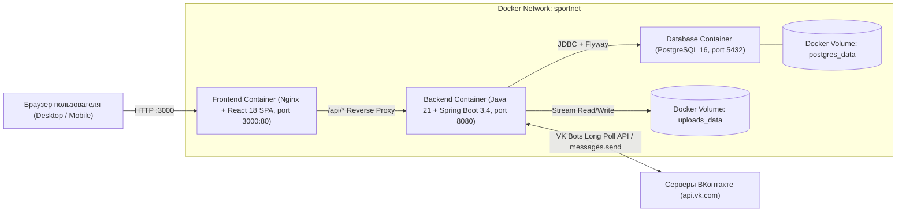
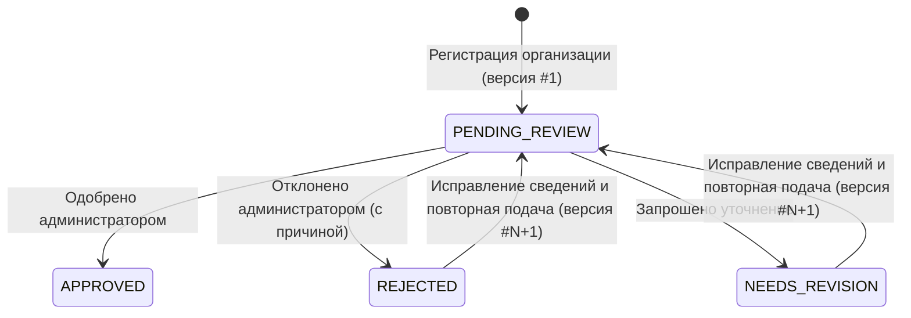
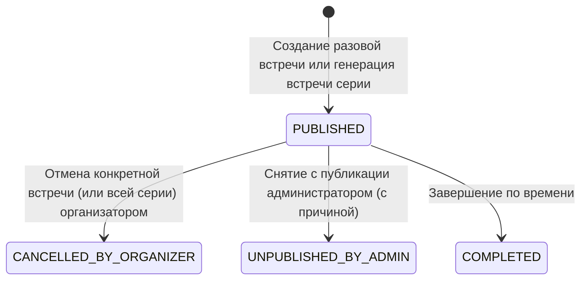
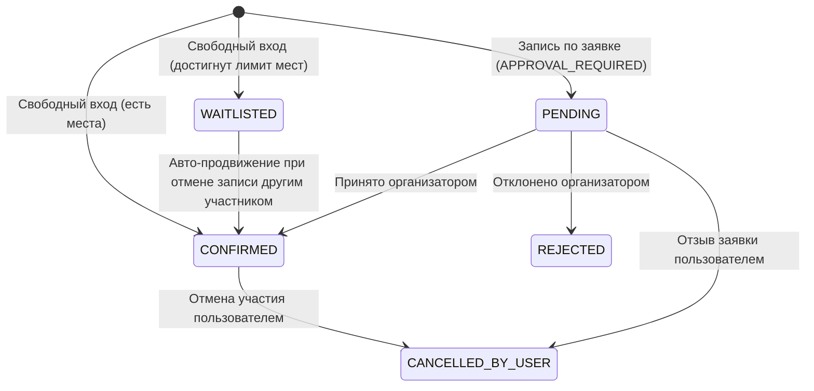

# Архитектура Спортивной Платформы «Точка Сбора»

## 1. Общая схема компонентов (Docker Compose)

## 2. Матрица ролей и прав доступа

| Операция | Гость | Обычный пользователь (`ROLE_USER`) | Личный организатор (`ROLE_USER` + автор события) | Представитель организации (`ROLE_USER` + владелец клуба) | Администратор (`ROLE_ADMIN`) |
| :--- | :---: | :---: | :---: | :---: | :---: |
| Просмотр каталога, публичных профилей и обсуждений | ✅ | ✅ | ✅ | ✅ | ✅ |
| Регистрация физлица или организации | ✅ | — | — | — | — |
| Создание личного мероприятия и добавление нового вида спорта | ❌ | ✅ | ✅ | ✅ | ✅ |
| Публикация мероприятия от имени организации | ❌ | ❌ | ❌ | ✅ *(только при `APPROVED`)* | ✅ |
| Свободная запись (`OPEN`) и подача заявки (`APPROVAL_REQUIRED`) | ❌ | ✅ | ✅ | ✅ | ✅ |
| Принятие / отклонение заявок участников на мероприятие | ❌ | ❌ | ✅ *(только своё событие)* | ✅ *(только событие клуба)* | ❌ *(не подменяет организатора)* |
| Поиск спортивных партнёров и управление знакомыми | ❌ | ✅ | ✅ | ✅ | ✅ |
| Отправка фото, видео, документов и ссылок в обсуждение | ❌ | ✅ | ✅ | ✅ | ✅ |
| Одобрение / отклонение организации с указанием причины | ❌ | ❌ | ❌ | ❌ | ✅ |
| Повторная отправка заявки организации после исправления | ❌ | ❌ | ❌ | ✅ *(владелец организации)* | — |
| Скрытие сообщения в обсуждении / снятие события с публикации | ❌ | ❌ | ❌ | ❌ | ✅ |
| Создание тикета / сообщения в чат техподдержки (свои) | ❌ | ✅ | ✅ | ✅ | ✅ |
| Ответы на все тикеты и диалоги чата техподдержки | ❌ | ❌ | ❌ | ❌ | ✅ |

## 3. Жизненные циклы ключевых сущностей

### 3.1. Жизненный цикл заявки организации (`OrganizationStatus`)

### 3.2. Жизненный цикл мероприятия (`EventStatus`) и регулярных серий

### 3.3. Жизненный цикл записи / заявки участника (`ParticipationStatus`)

