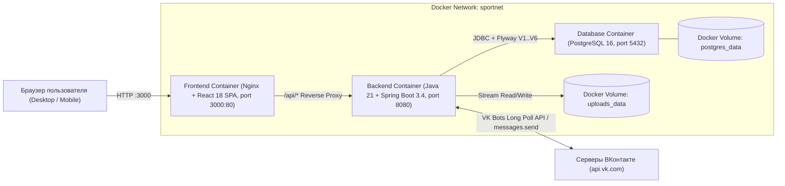
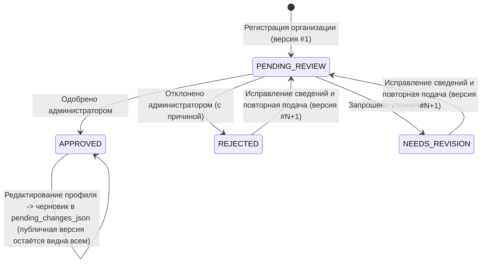
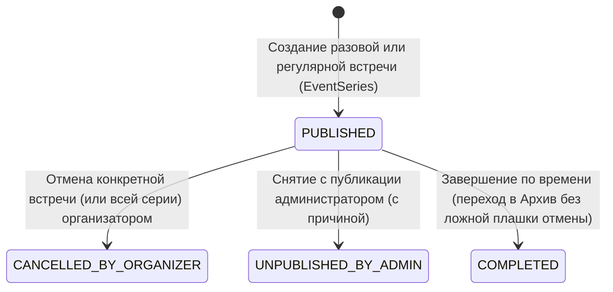
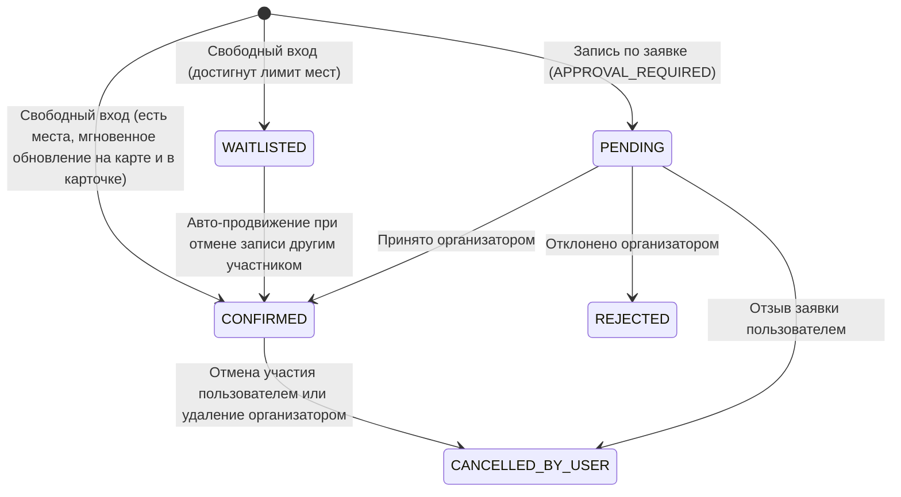

# Архитектура Спортивной Платформы «Точка Сбора»

## 1. Общая схема компонентов (Docker Compose)

## 2. Матрица ролей и прав доступа

| Операция | Гость | Обычный пользователь (`ROLE_USER`) | Автор встречи / сообщества (`ROLE_USER`) | Аккаунт организации (`ROLE_USER` + владелец организации) | Администратор (`ROLE_ADMIN`) |
| :--- | :---: | :---: | :---: | :---: | :---: |
| Просмотр карты, каталога встреч, сообществ, организаций и обсуждений | ✅ | ✅ | ✅ | ✅ | ✅ |
| Регистрация физлица или аккаунта организации | ✅ | — | — | — | — |
| Создание личного мероприятия и пользовательского сообщества (`COMMUNITY`) | ❌ | ✅ | ✅ | ❌ *(аккаунт организации обезличен)* | ✅ |
| Публикация мероприятия от имени официальной организации | ❌ | ❌ | ❌ | ✅ *(только от имени своей организации в статусе `APPROVED`)* | ✅ |
| Добавление нового вида спорта из UI | ❌ | ✅ | ✅ | ✅ | ✅ |
| Свободная запись (`OPEN`) и подача заявки (`APPROVAL_REQUIRED`) | ❌ | ✅ | ✅ | ✅ | ✅ |
| Принятие / отклонение заявок и удаление участников встречи | ❌ | ❌ | ✅ *(только своё событие)* | ✅ *(только событие своей организации)* | ❌ *(не подменяет организатора)* |
| Поиск друзей («Спорт-дейтинг») и личные сообщения (`Direct Messages`) | ❌ | ✅ | ✅ | ❌ *(скрыт из поиска друзей)* | ✅ |
| Отправка фото, видео, документов и ссылок в обсуждение | ❌ | ✅ | ✅ | ✅ | ✅ |
| Одобрение / отклонение заявки организации и модерация её правок | ❌ | ❌ | ❌ | ❌ | ✅ |
| Повторная отправка заявки или подача правок в профиль организации | ❌ | ❌ | ❌ | ✅ *(владелец организации)* | — |
| Удаление сообщества (`COMMUNITY`) | ❌ | ❌ | ✅ *(создатель сообщества)* | ❌ | ✅ *(с обязательным указанием причины)* |
| Скрытие сообщения в обсуждении / снятие события с публикации | ❌ | ❌ | ❌ | ❌ | ✅ |
| Создание обращения (`TCK-XXXXX`) / сообщения в чат техподдержки | ❌ | ✅ | ✅ | ✅ | ✅ |
| Ответы на все обращения и диалоги чата техподдержки | ❌ | ❌ | ❌ | ❌ | ✅ |

## 3. Жизненные циклы ключевых сущностей

### 3.1. Жизненный цикл заявки организации (`OrganizationStatus`) и теневой премодерации правок (`pending_changes_json`)

### 3.2. Жизненный цикл мероприятия (`EventStatus`) и регулярных серий

### 3.3. Жизненный цикл записи / заявки участника (`ParticipationStatus`)

